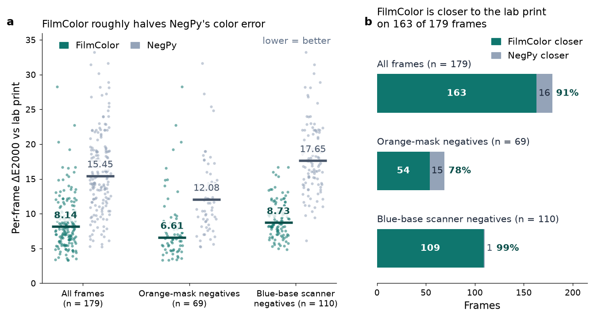
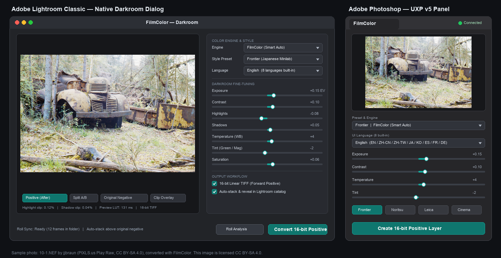

<div align="center">

# FilmColor

**Physics-First Film Negative Inversion for Adobe Lightroom Classic & Adobe Photoshop**

**English** · [简体中文](README.zh-CN.md) · [Download](https://github.com/Guuuu233/FilmColor-AI/releases/latest)

[](https://github.com/Guuuu233/FilmColor-AI/releases/latest)
[](#installation)
[](#native-plugin-experience)
[](#8-built-in-languages)

*True 16-bit forward positive output · Median ΔE2000 8.14 vs NegPy 15.45 on 179 blind frames · Beats NegPy on 91% of them · Zero-dependency offline bundles*

</div>

---


> **Color-negative RAW camera scans that photographers shared on [PIXLS.us](https://discuss.pixls.us/c/playraw/30) under [CC BY-SA 4.0](https://creativecommons.org/licenses/by-sa/4.0/)**, converted directly to 16-bit positives by **FilmColor** with no manual adjustments. Left: original orange-masked negative. Center: **Frontier** preset. Right: **Leica Look** preset. Some of these public frames were among the unpaired negatives used in training, so they show typical output rather than blind accuracy; see the [blind benchmark](#blind-color-accuracy-benchmark) for frames the model never saw. Negatives by hpbirkeland, jonathanBieler and clennep; this composite is licensed CC BY-SA 4.0 ([image credits](docs/assets/CREDITS.md)).

---

## Why FilmColor?

Most film conversion tools force a trade-off between **color accuracy**, **editing ergonomics**, and **ecosystem lock-in**. FilmColor runs a calibrated physical density-space inversion engine locally, inside both **Adobe Lightroom Classic** and **Adobe Photoshop**:

| Capability | **FilmColor** | Negative Lab Pro (NLP) | NegPy |
| :--- | :--- | :--- | :--- |
| **Adobe Lightroom Classic Native Plugin** | **Yes** (Darkroom dialog + auto-stack) | Yes (Dialog) | No (standalone app) |
| **Adobe Photoshop Native Plugin** | **Yes** (UXP v5 panel, 16-bit layer) | No | No |
| **Editing Direction in Lightroom** | **True 16-bit forward positive** — native sliders, tone curves & AI masks work normally | Inverted tone curves — sliders run backwards until you export a positive copy | External export required |
| **Blind Color Error (ΔE2000, lower is better)** | **8.14 median** / 13.14 P90 (`n=179`) | Not benchmarked (closed source) | 15.45 median / 22.93 P90 (`n=179`) |
| **Multi-Frame Roll Sync** | **Built-in** (cross-frame film-base & cast pooling) | Built-in (Roll Analysis) | Manual / per-roll |
| **Sprocket & Backlight Guard** | **Automatic** (rejects film borders & backlight bleed) | Requires manual border crop % | Manual border crop |
| **Zero-Dependency Offline Installer** | **Yes** (macOS & Windows) | Commercial installer | Python / standalone |
| **Built-in UI Languages** | **8 languages** (EN, ZH-CN, ZH-TW, JA, KO, ES, FR, DE) | English only | English |
| **License & Cost** | **Free & Open Source** | Paid ($99) | Open Source |

---

## Blind Color Accuracy Benchmark

FilmColor and **NegPy** were scored on the same **179-frame frozen blind holdout**: 69 orange-mask negatives (camera-scanned RAW and scanner) and 110 blue-base scanner negatives. None of these frames was used to train or tune FilmColor. Each conversion is compared with the lab print of the same frame using the perceptual color difference **CIEDE2000 (ΔE2000, lower is better)**, after automatic registration. FilmColor is scored engine-only (no style preset), with roll pooling.



| Blind holdout subset | Frames | **FilmColor** median / mean / P90 | NegPy median / mean / P90 | **Frames where FilmColor is closer to the lab print** |
| :--- | :---: | :---: | :---: | :---: |
| **All frozen holdout** | **179** | **8.14 / 8.75 / 13.14** | 15.45 / 16.10 / 22.93 | **163 / 179 (91.1%)** |
| **Orange-mask camera & scanner** | **69** | **6.61 / 7.94 / 14.20** | 12.08 / 12.59 / 18.22 | **54 / 69 (78.3%)** |
| **Blue-base scanner negatives** | **110** | **8.73 / 9.26 / 12.65** | 17.65 / 18.30 / 23.99 | **109 / 110 (99.1%)** |

The per-frame differences are significant in every subset (two-sided Wilcoxon signed-rank test: *p* = 2.7 × 10⁻²⁷ overall, 6.0 × 10⁻⁸ orange-mask, 9.5 × 10⁻²⁰ blue-base). Without roll pooling (single-frame mode), FilmColor's median ΔE2000 is 8.10.

**Notes on the benchmark**

- NegPy version: v0.69.0. Negative Lab Pro is closed source and runs only inside Lightroom's interactive dialog, so it could not be scored automatically.
- Two snow scenes (A184, A189) are scored with film-base densities cached from an earlier estimator (about half the value the plugin measures itself), so their scores here do not reflect the plugin's output; both frames render correctly in the plugin.
- Reproduce with `scripts/eval_ho179.py` (frozen holdout data is not distributed).

### Runtime Speed & Memory Footprint

Measured on an Apple Silicon Mac (18 GiB RAM, CPU only) with a 20-megapixel camera-scanned RAW negative; ranges cover two runs.

| Operation | Measured |
| :--- | :--- |
| **First preview of a 20 MP camera RAW** | **2.0–3.1 s** |
| **Preview refresh after changing a preset or slider** | **64–85 ms** |
| **Full-resolution 16-bit TIFF export (20 MP)** | **24–26 s** |
| **Idle memory of the local engine** | **about 58 MB** (caches trimmed after 5 min idle, exits after 30 min) |
| **Offline bundle size** | **34.0 MB** zip (macOS arm64) |

---

## Native Plugin Experience

FilmColor integrates directly into the tools film photographers already use — no browser tabs, no cloud uploads, and no Python setup required.



> Sample photo: `10-1.NEF` by jjbraun ([PIXLS.us](https://discuss.pixls.us/t/43472), CC BY-SA 4.0); this image is licensed CC BY-SA 4.0 ([image credits](docs/assets/CREDITS.md)).

### Adobe Lightroom Classic (`FilmColor.lrplugin`)
- **True 16-bit Forward Positive Workflow**: Outputs a calibrated 16-bit linear TIFF positive automatically imported and stacked above your original negative — every Lightroom slider, tone curve, HSL wheel, and AI mask works in the natural forward direction.
- **Exact Crop, Straighten & Orientation Inheritance**: Reproduces your Lightroom crop, straighten angle and rotation, and samples the film base inside the crop, automatically rejecting sprocket holes and backlight borders.
- **Roll Analysis & Batch Sync**: Pool film-base and color-cast statistics across an entire roll for consistent frame-to-frame color.
- **Interactive Darkroom Dialog**: Live Positive / Split A-B / Original Negative / Clip Overlay views with exposure, contrast, highlights, shadows, white balance, tint, and saturation sliders.

### Adobe Photoshop (UXP panel, `.ccx` installer)
- **Native UXP v5 Panel**: Matches the Adobe Spectrum dark UI with one-click preset chips, live preview, and fine-tuning sliders.
- **Auto-Starting Local Bridge**: Automatically launches the bundled local engine on demand — no terminal commands.
- **Non-Destructive 16-bit Positive Layer**: Inserts the converted 16-bit positive directly into your active document for retouching and printing.

---

## 10 Scene-Adaptive Style Presets

Each preset adapts to the frame's own tonal range and color content, and switches in real time (the preview refreshes in under 0.1 s, via a 33³ float32 trilinear 3D LUT):


> Negative: `1997_0001.cr2` by hpbirkeland ([PIXLS.us](https://discuss.pixls.us/t/20293), CC BY-SA 4.0); this image is licensed CC BY-SA 4.0 ([image credits](docs/assets/CREDITS.md)).

`Frontier` · `Noritsu` · `Leica Look` · `Standard` · `Natural` · `Portrait` · `Vivid` · `Print Classic` · `Cinema` · `Linear`

---

## 8 Built-in Languages

Switch interface language live inside both Lightroom Classic and Photoshop with no restart:

- **English** (`en`)
- **简体中文** (`zh-CN`)
- **繁體中文** (`zh-TW`)
- **日本語** (`ja`)
- **한국어** (`ko`)
- **Español** (`es`)
- **Français** (`fr`)
- **Deutsch** (`de`)

---

## Installation

### Option 1 — Zero-Dependency Offline Bundle (Recommended)

Download the pre-built archive for your platform from the **[latest release](https://github.com/Guuuu233/FilmColor-AI/releases/latest)** — no Python, Conda, or command-line tools required:

- **macOS (Apple Silicon)**: the archive ending in `macOS-arm64.zip` (34.0 MB)
- **Windows (64-bit)**: the archive ending in `Windows-x64.zip`

#### Lightroom Classic Setup
1. Unzip the downloaded archive to a permanent folder.
2. macOS: double-click `Install_FilmColor_macOS.command` (right-click → **Open** if Gatekeeper asks). Windows: run `Install_FilmColor_Windows.bat`. Or add it manually: **File** → **Plug-in Manager...** → **Add** → select `FilmColor.lrplugin`.
3. Select any scanned negative(s) → **File** → **Plug-in Extras** → **FilmColor Negative Conversion...** (or **FilmColor Quick Convert** for one-click batch conversion).

#### Photoshop Setup
1. Double-click the `.ccx` file in the unzipped folder (installed via Creative Cloud Desktop), **or** load `plugins/photoshop-uxp/manifest.json` via the Adobe UXP Developer Tool.
2. Open **Plugins** → **FilmColor** in Photoshop.

Updating: install the new release over the existing copy; your Lightroom and Photoshop settings are kept.

---

### Option 2 — Install from Source (Developers)

Requires Python 3.12 or 3.13 and [`uv`](https://docs.astral.sh/uv/) (or `pip`):

```bash
git clone https://github.com/Guuuu233/FilmColor-AI.git
cd FilmColor-AI
uv sync --no-group ml
```

Run the test suite:

```bash
uv run pytest
```

Build a standalone zero-dependency bundle locally:

```bash
uv run --no-group ml --with pyinstaller scripts/build_standalone.py --out dist
```

---

## Architecture Highlights

- **100% Local & Private**: All RAW decoding (`rawpy` / LibRaw) and color inversion run on your machine via `127.0.0.1:18765` — no telemetry, no cloud calls.
- **3 Selectable Engines**:
  - **FilmColor (recommended, default)** — Calibrated physical inversion plus a learned residual color model, trained with a perceptual objective (tonal range, chroma, clean blacks) on 186 paired lab-print frames and 177 visually verified frames, with adaptive style presets.
  - **Physical Direct Engine** — Pure analytical density-space inversion.
  - **Classic Engine** — Legacy baseline engine retained for backward compatibility.
- **Lean Runtime**: Inference uses only `numpy`, `scipy`, `Pillow`, `rawpy`, `tifffile`, and `exifread` — no PyTorch or other deep-learning runtime.
