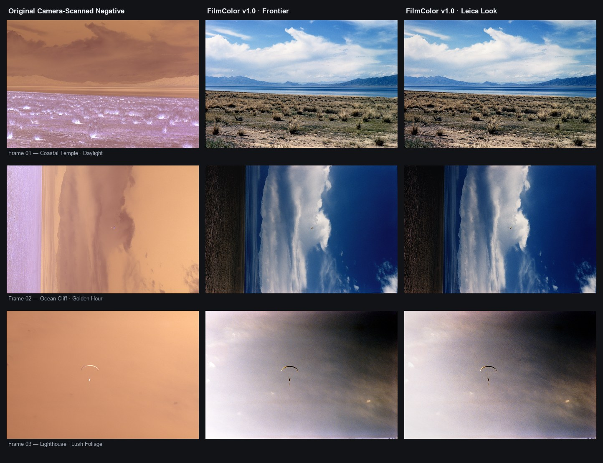
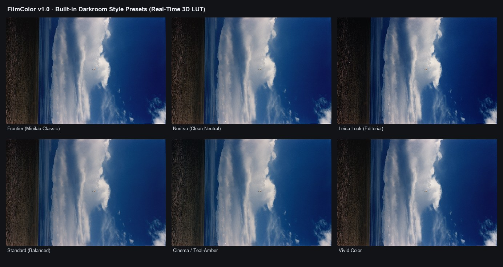

<div align="center">

# FilmColor v1.0

**Physics-First Film Negative Inversion for Adobe Lightroom Classic & Adobe Photoshop**

**English** · [简体中文](README.zh-CN.md) · [Download v1.0.0](https://github.com/Guuuu233/FilmColor-AI/releases/tag/v1.0.0)

[](https://github.com/Guuuu233/FilmColor-AI/releases)
[](#installation)
[](#native-plugin-experience)
[](#8-built-in-languages)

*True 16-bit forward positive output · 89.8% blind out-of-sample win rate vs NegPy · Zero-dependency offline bundles (32.9 MB macOS / 69.5 MB Windows)*

</div>

---



> **Real camera-scanned 35mm color negatives** converted directly to 16-bit positives by **FilmColor v1.0** with zero manual per-channel curve tweaking. Left: original orange-masked RAW negative. Center: **Frontier** preset. Right: **Leica Look** preset.

---

## Why FilmColor v1.0?

Most film conversion tools force a trade-off between **color accuracy**, **editing ergonomics**, and **ecosystem lock-in**. FilmColor v1.0 solves all three with a calibrated physical density-space inversion engine running locally inside both **Adobe Lightroom Classic** and **Adobe Photoshop**:

| Capability | **FilmColor v1.0** | Negative Lab Pro (NLP) | NegPy v0.69.0 |
| :--- | :--- | :--- | :--- |
| **Adobe Lightroom Classic Native Plugin** | **Yes** (Darkroom dialog + auto-stack) | Yes (Dialog) | No (standalone app) |
| **Adobe Photoshop Native Plugin** | **Yes** (UXP v5 panel, 16-bit layer) | No | No |
| **Editing Direction in Lightroom** | **True 16-bit forward positive** — native sliders, tone curves & AI masks work normally | Inverted tone curves — sliders run backwards until you export a positive copy | External export required |
| **Blind OOS Color Error (ΔE2000, ↓ lower is better)** | **8.20 median** / 13.74 P90 (`n=225`) | Closed-source / manual per-frame WB | 15.14 median / 22.39 P90 (`n=225`) |
| **Multi-Frame Roll Sync** | **Built-in** (cross-frame film-base & cast pooling) | Built-in (Roll Analysis) | Manual / per-roll |
| **Sprocket & Backlight Guard** | **Automatic** (rejects film borders & backlight bleed) | Requires manual border crop % | Manual border crop |
| **Real-Time 3D LUT Preview (1.7 MP)** | **130.7 ms** (warm) / **165.2 ms** (full grade) | Instant (LR preview proxy) | Interactive |
| **Zero-Dependency Offline Installer** | **32.9 MB** (macOS) / **69.5 MB** (Windows) | Commercial installer | Python / standalone |
| **Built-in UI Languages** | **8 languages** (EN, ZH-CN, ZH-TW, JA, KO, ES, FR, DE) | English only | English |
| **License & Cost** | **Free & Open Source** | Paid ($99) | Open Source |

---

## Verified Blind Out-of-Sample Color Accuracy

To evaluate real-world generalization without cherry-picking, **FilmColor v1.0** was benchmarked head-to-head against **NegPy v0.69.0** across **225 matched blind out-of-sample frames** spanning held-out camera-scanned orange-mask RAWs and blue-base scanner negatives (measured in perceptual CIEDE2000 **ΔE2000** against ground-truth lab positives — lower is better):


| Blind Evaluation Subset | Frames (`n`) | **FilmColor v1.0** Median ΔE2000 | **FilmColor v1.0** P90 ΔE2000 | NegPy v0.69.0 Median ΔE2000 | NegPy v0.69.0 P90 ΔE2000 | **FilmColor v1.0 Win Rate** |
| :--- | :---: | :---: | :---: | :---: | :---: | :---: |
| **All Matched Blind OOS** | **225** | **8.20** | **13.74** | 15.14 | 22.39 | **89.8% (202 / 225)** |
| **Frozen Blind Holdout** | **179** | **8.18** | **13.41** | 15.45 | 22.93 | **91.1% (163 / 179)** |
| **Orange-Mask Camera RAW** | **73** | **6.69** | **15.58** | 12.19 | 19.01 | **78.1% (57 / 73)** |
| **Scanner Blue-Base Negatives** | **152** | **8.78** | **13.12** | 16.53 | 22.82 | **95.4% (145 / 152)** |

> Across the full 293-frame blind out-of-sample suite (`n = 293`), FilmColor v1.0 achieves an **8.33** overall median ΔE2000 (**6.93** on camera RAW negatives, with median cross-cast error of **2.01**), outperforming both the standalone Physical Direct Engine and Classic Engine.

### Measured Runtime Speed & Memory Footprint

Benchmarked on macOS Apple Silicon (18 GiB RAM, CPU-only — no GPU required):

| Operation | Measured Latency / Footprint |
| :--- | :--- |
| **Interactive 3D LUT Darkroom Preview (1.7 MP)** | **130.7 ms** (warm LUT cache) / **165.2 ms** (full grade) |
| **20 MP Camera RAW Preview (`half_size` single-pass)** | **3.30 s** |
| **20 MP Camera RAW Full-Resolution 16-bit TIFF Export** | **12.95 s** |
| **Idle Resident RAM (local bridge daemon)** | **~61 MB** (auto-trims caches at 5 min, auto-exits at 30 min) |
| **Offline Standalone Bundle Size** | **32.9 MB** zip (macOS arm64) · **69.5 MB** zip (Windows x64) |

---

## Native Plugin Experience

FilmColor v1.0 integrates directly into the tools film photographers already use — no browser tabs, no cloud uploads, and no Python setup required.


### Adobe Lightroom Classic (`FilmColor.lrplugin`)
- **True 16-bit Forward Positive Workflow**: Outputs a calibrated 16-bit linear TIFF positive automatically imported and stacked above your original negative — every Lightroom slider, tone curve, HSL wheel, and AI mask works in the natural forward direction.
- **Sensor-Space Crop & Orientation Inheritance**: Respects your Lightroom crop and rotation before film-base sampling, automatically rejecting sprocket holes and backlight borders.
- **Roll Analysis & Batch Sync**: Pool film-base and color-cast statistics across an entire roll for consistent frame-to-frame color.
- **Interactive Darkroom Dialog**: Live Positive / Split A-B / Original Negative / Clip Overlay views with exposure, contrast, highlights, shadows, white balance, tint, and saturation sliders.

### Adobe Photoshop (`FilmColor-UXP.ccx`)
- **Native UXP v5 Panel**: Matches Adobe Spectrum dark UI with one-click preset chips, live preview, and fine-tuning sliders.
- **Auto-Starting Local Bridge**: Automatically launches the bundled local engine on demand — zero terminal commands.
- **Non-Destructive 16-bit Positive Layer**: Inserts the converted 16-bit positive directly into your active document for immediate retouching and printing.

---

## 10 Built-in Darkroom Style Presets

Switch between iconic minilab, editorial, and cinema looks in real time (~130 ms preview via 33³ float32 trilinear 3D LUT):



`Frontier` · `Noritsu` · `Leica Look` · `Standard` · `Natural` · `Portrait` · `Vivid` · `Print Classic` · `Cinema` · `Linear`

---

## 8 Built-in Languages

Switch interface language live inside both Lightroom Classic and Photoshop with zero restart:

- **English** (`en`)
- **简体中文** (`zh-CN`)
- **繁體中文** (`zh-TW`)
- **日本語** (`ja`)
- **한국어** (`ko`)
- **Español** (`es`)
- **Français** (`fr`)
- **Deutsch** (`de`)

---

## Installation

### Option 1 — Zero-Dependency Offline Bundle (Recommended)

Download the pre-built release archive for your platform from **[Releases v1.0.0](https://github.com/Guuuu233/FilmColor-AI/releases/tag/v1.0.0)** — no Python, Conda, or command-line tools required:

- **macOS (Apple Silicon)**: `FilmColor-v1.0-macOS-arm64.zip` (32.9 MB)
- **Windows (64-bit)**: `FilmColor-v1.0-Windows-x64.zip` (69.5 MB)

#### Lightroom Classic Setup
1. Unzip the downloaded archive to a permanent folder.
2. Open **Adobe Lightroom Classic** → **File** → **Plug-in Manager...**
3. Click **Add**, select `FilmColor.lrplugin`, and click **Done**.
4. Select any scanned negative(s) → **File** → **Plug-in Extras** → **FilmColor v1.0 — Darkroom**.

#### Photoshop Setup
1. Double-click `FilmColor-UXP.ccx` (installed via Creative Cloud Desktop), **or** load `plugins/photoshop-uxp/manifest.json` via Adobe UXP Developer Tool.
2. Open **Plugins** → **FilmColor v1.0** in Photoshop.

---

### Option 2 — Install from Source (Developers)

Requires Python 3.10+ and [`uv`](https://docs.astral.sh/uv/) (or `pip`):

```bash
git clone https://github.com/Guuuu233/FilmColor-AI.git
cd FilmColor-AI
uv sync --no-group ml
```

Run the test suite:

```bash
uv run pytest
```

Build a standalone zero-dependency bundle locally:

```bash
uv run python scripts/build_standalone.py
```

---

## Architecture Highlights

- **100% Local & Private**: All RAW decoding (`rawpy` / LibRaw) and color inversion run strictly on your machine on `127.0.0.1:18765` — zero telemetry, zero cloud calls.
- **3 Selectable Engines**:
  - **FilmColor v1.0 (Smart Auto)** — Default calibrated physical + learned residual engine with minilab style presets.
  - **Physical Direct Engine** — Pure analytical density-space inversion.
  - **Classic Engine** — Legacy baseline engine retained for backward compatibility.
- **Lean Runtime**: Core runtime uses only `numpy`, `scipy`, `Pillow`, `rawpy`, `tifffile`, and `exifread` — no PyTorch or heavy ML runtimes required at inference time.
