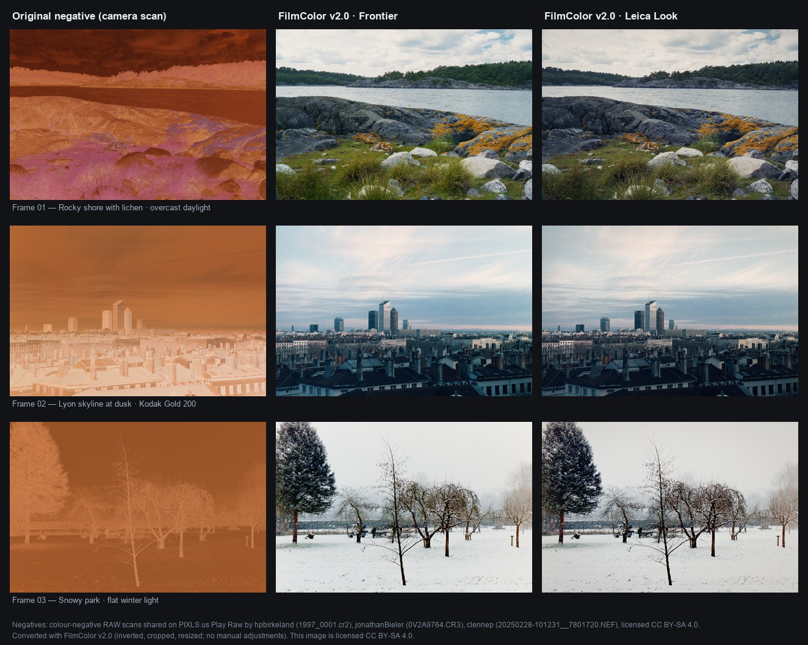
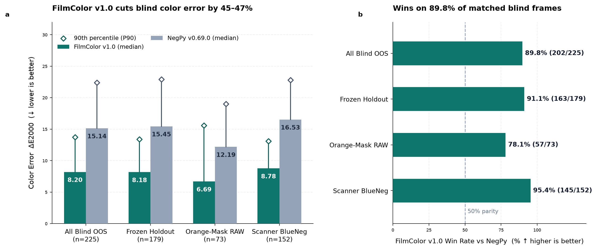
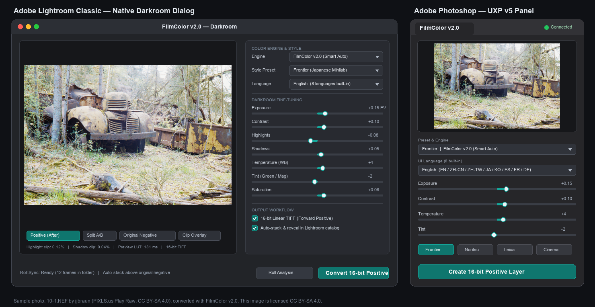
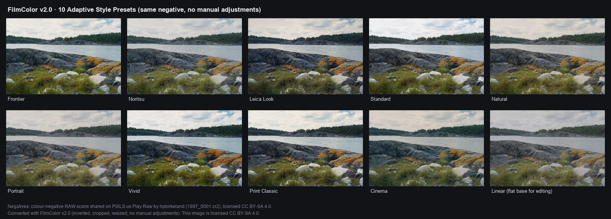

<div align="center">

# FilmColor v2.0

**面向 Adobe Lightroom Classic 与 Adobe Photoshop 的物理优先胶片负片反相引擎**

[English](README.md) · **简体中文** · [下载 v2.0.0 正式版](https://github.com/Guuuu233/FilmColor-AI/releases/tag/v2.0.0)

[](https://github.com/Guuuu233/FilmColor-AI/releases)
[](#安装指南)
[](#原生插件界面与工作流)
[](#内置-8-国语言)

*真 16-bit 正向正片输出 · 179 帧盲测中位 ΔE2000 8.14（NegPy 为 15.45）· 逐帧对比 91% 优于 NegPy · 零依赖离线安装包*

</div>

---



> **摄影师在 [PIXLS.us](https://discuss.pixls.us/c/playraw/30) 以 [CC BY-SA 4.0](https://creativecommons.org/licenses/by-sa/4.0/) 许可公开分享的彩色负片 RAW 翻拍**，经 **FilmColor v2.0** 一键直出 16-bit 正片，未做任何手动调整。左：原始带橙色色罩负片；中：**Frontier** 富士冲印预设；右：**Leica Look** 徕卡影调预设。其中部分画格曾作为无配对样本参与训练，所以这组图展示的是一般效果，不是盲测；模型从未见过的画格上的准确度见下方[盲测](#盲测色彩准确度对比)。负片作者：hpbirkeland、jonathanBieler、clennep；本图以 CC BY-SA 4.0 发布（[图片署名](docs/assets/CREDITS.md)）。

---

## v2.0 新特性

- **全新默认校色引擎。** 残差校色模型改用感知目标重新训练，专门保护影调层次、色彩饱满度与干净黑位；训练数据扩充为 **186 帧有冲印参考的配对负片 + 177 帧人工视觉确认负片**。在冻结盲测集上，中位色差由 8.19 降至 **8.14**，均值由 8.95 降至 **8.75**，P90 由 13.46 降至 **13.14** ΔE2000；逐帧 73 帧变好、32 帧变差（Wilcoxon *p* = 3.0 × 10⁻⁶，详见下文）。
- **10 套场景自适应风格预设。** `Frontier`、`Noritsu`、`Leica Look` 等预设会根据每一帧的影调与色彩内容自动调整，而非套用固定风格。
- **精确继承 Lightroom 裁剪与拉直。** 在 Lightroom Classic 中设置的裁剪框与拉直角度会在转换后的正片中精确还原。
- **更快、更省资源。** 全分辨率 16-bit 导出改为分块写入，峰值内存显著降低；LZW 压缩 TIFF 解码提速 4.4 倍；本地引擎的解码、渲染与编码均在缓存锁之外执行，拖动滑块更跟手。
- **稳定性加固。** 修复了扫描仪 TIFF 解析、反相、导出、本地引擎与两款插件中的 20 余处健壮性问题（包括长时间批量导出时的安全关闭，以及向 Lightroom / Photoshop 返回数据时的 NaN 防护）。
- **原地升级。** 插件标识保持不变，直接覆盖安装 v1.0 即可保留 Lightroom 与 Photoshop 中的设置。

---

## 为什么选择 FilmColor？

市面上大多数负片转换工具往往需要在**色彩准确度**、**后期调色手感**与**软件生态**之间妥协。FilmColor 基于标定物理密度空间反相模型，在本地原生运行于 **Adobe Lightroom Classic** 与 **Adobe Photoshop** 中：

| 核心维度 | **FilmColor v2.0** | Negative Lab Pro (NLP) | NegPy v0.69.0 |
| :--- | :--- | :--- | :--- |
| **Lightroom Classic 原生插件** | **支持**（原生暗房弹窗 + 自动堆叠） | 支持（弹窗） | 不支持（独立软件） |
| **Photoshop 原生插件** | **支持**（UXP v5 面板，直出 16-bit 图层） | 不支持 | 不支持 |
| **Lightroom 后期调色方向** | **真 16-bit 正向正片** — 所有原生滑块、曲线与 AI 蒙版均正向生效 | 反转色调曲线 — 曝光/高光等滑块方向相反，需导出副本才恢复正向 | 需在外部转换后导入 |
| **盲测色彩误差（ΔE2000，越低越准）** | **中位 8.14** / P90 13.14（`n=179`） | 未参与测试（闭源） | 中位 15.45 / P90 22.93（`n=179`） |
| **整卷统一分析（Roll Sync）** | **内置**（跨帧片基与色偏联合统计） | 内置（Roll Analysis） | 手动 / 按卷调整 |
| **齿孔与背光边缘自动过滤** | **全自动**（自动剔除片边与漏光干扰） | 需手动设置裁边百分比 | 需手动裁边 |
| **零依赖独立离线安装包** | **支持**（macOS 与 Windows） | 商业安装包 | Python / 独立包 |
| **内置界面语言** | **8 国语言**（简中、繁中、英、日、韩、西、法、德） | 仅英语 | 仅英语 |
| **授权与价格** | **免费开源** | 付费（$99） | 开源 |

---

## 盲测色彩准确度对比

我们在同一套 **179 帧冻结盲测集**上，对 FilmColor v2.0、FilmColor v1.0 与 **NegPy v0.69.0** 逐帧评分：其中 69 帧为橙色色罩负片（相机翻拍 RAW 与扫描仪），110 帧为扫描仪蓝色片基负片。这些负片从未参与任何版本 FilmColor 的训练或调参。每张转换结果在自动配准后与同一帧的冲印参考正片比较，指标为感知色差 **CIEDE2000（ΔE2000，越低越准）**。FilmColor 按引擎直出（不加风格预设）并启用整卷统计评分，与 v1.0 公布数据的测法完全一致。



| 盲测子集 | 帧数 | **v2.0** 中位 / 均值 / P90 | v1.0 中位 / 均值 / P90 | NegPy v0.69.0 中位 / 均值 / P90 | **v2.0 优于 NegPy** | **v2.0 对比 v1.0**（变好 / 变差） |
| :--- | :---: | :---: | :---: | :---: | :---: | :---: |
| **全部冻结盲测集** | **179** | **8.14 / 8.75 / 13.14** | 8.19 / 8.95 / 13.46 | 15.45 / 16.10 / 22.93 | **163 / 179（91.1%）** | **73 / 32**（*p* = 3.0 × 10⁻⁶） |
| **橙色色罩（相机翻拍与扫描仪）** | **69** | **6.61 / 7.94** / 14.20 | 6.68 / 8.12 / **13.48** | 12.08 / 12.59 / 18.22 | **54 / 69（78.3%）** | **47 / 22**（*p* = 8.8 × 10⁻⁴） |
| **扫描仪蓝色片基负片** | **110** | **8.73 / 9.26 / 12.65** | 8.77 / 9.47 / 13.45 | 17.65 / 18.30 / 23.99 | **109 / 110（99.1%）** | **26 / 10**（*p* = 9.2 × 10⁻⁴） |

*p* 值：v2.0 与 v1.0 逐帧 ΔE2000 的双侧 Wilcoxon 符号秩检验。关闭整卷统计（单帧模式）时，v2.0 中位 ΔE2000 为 8.10，v1.0 为 8.35。

**测试说明**

- v1.0 版 README 另外报告了 46 帧（合计 `n = 225`）。其中 4 帧现已进入 v2.0 训练集，v2.0 在这组数据上不再是盲测，因此三者统一只在 179 帧冻结集上比较。
- 在该盲测集上，v2.0 橙色色罩子集的 P90 略高（14.20，v1.0 为 13.48），主要来自两张雪景（A184、A189）：评测缓存中保存的片基密度由早期估计器测得，约只有现行流程实测值的一半。v2.0 插件会自行测量片基，这两张实际输出正常。
- 复现脚本：`scripts/eval_ho179.py`（冻结盲测数据不公开分发）。

### 运行速度与内存占用

测试平台：macOS Apple Silicon（18 GiB 内存，纯 CPU）。交互速度数据来自 v1.0 正式版构建，v2.0 在此基础上进一步优化了导出与本地引擎。

| 操作场景 | 实测耗时 / 资源占用 |
| :--- | :--- |
| **实时 3D LUT 暗房调色预览（1.7 MP）** | **130.7 ms**（热缓存）/ **165.2 ms**（完整重算） |
| **2000 万像素相机 RAW 首次预览（半尺寸单遍解码）** | **3.30 s** |
| **2000 万像素相机 RAW 全分辨率 16-bit TIFF 导出** | **12.95 s** |
| **后台本地引擎常驻内存** | **约 61 MB**（空闲 5 分钟自动清理缓存，30 分钟自动退出） |
| **零依赖离线发布包体积（v2.0）** | **34.0 MB**（macOS arm64） |

---

## 原生插件界面与工作流

FilmColor 直接嵌入摄影师最常用的后期软件——无需打开浏览器、无需上传云端、无需配置 Python 环境。



> 示例照片：jjbraun 的 `10-1.NEF`（[PIXLS.us](https://discuss.pixls.us/t/43472)，CC BY-SA 4.0）；本图以 CC BY-SA 4.0 发布（[图片署名](docs/assets/CREDITS.md)）。

### Adobe Lightroom Classic（`FilmColor.lrplugin`）
- **真 16-bit 正向正片工作流**：输出标定后的 16-bit 线性正片 TIFF，自动导入图库并堆叠在原始负片上方——所有 Lightroom 原生滑块、曲线、HSL 与 AI 蒙版均正向工作。
- **精确继承裁剪、拉直与方向**：还原你在 Lightroom 中设置的裁剪框、拉直角度与旋转，并在裁剪范围内采样片基，自动屏蔽齿孔与背光板漏光。
- **整卷统一分析（Roll Analysis）**：跨帧聚合同一卷胶片的片基与色偏特征，保证整卷色调连贯一致。
- **实时暗房弹窗**：支持正片 / 左右分屏对比 / 原始负片 / 溢出警告视图，内置曝光、对比度、高光、阴影、色温、色调、饱和度调节。

### Adobe Photoshop（`FilmColor-v2.0-Photoshop.ccx`）
- **原生 UXP v5 面板**：融合 Adobe Spectrum 深色界面，提供一键风格标签、实时预览与暗房滑块。
- **自动拉起本地引擎**：打开面板即可按需启动内置本地计算服务，无需命令行。
- **非破坏性 16-bit 正片图层**：一键将反相后的 16-bit 正片写入当前文档的新图层，便于精修与输出。

---

## 内置 10 套场景自适应风格预设

每套预设都会根据当前画面的影调与色彩内容自适应调整，并通过 33³ float32 三线性 3D LUT 实时切换（预览约 130 ms）：



> 负片：hpbirkeland 的 `1997_0001.cr2`（[PIXLS.us](https://discuss.pixls.us/t/20293)，CC BY-SA 4.0）；本图以 CC BY-SA 4.0 发布（[图片署名](docs/assets/CREDITS.md)）。

`Frontier（富士冲印）` · `Noritsu（诺日士）` · `Leica Look（徕卡影调）` · `Standard（标准平衡）` · `Natural（自然纪实）` · `Portrait（人像肤色）` · `Vivid（鲜明）` · `Print Classic（经典相纸）` · `Cinema（电影质感）` · `Linear（线性底稿）`

---

## 内置 8 国语言

在 Lightroom Classic 与 Photoshop 面板内均可实时切换界面语言，无需重启：

- **简体中文**（`zh-CN`）
- **繁體中文**（`zh-TW`）
- **English**（`en`）
- **日本語**（`ja`）
- **한국어**（`ko`）
- **Español**（`es`）
- **Français**（`fr`）
- **Deutsch**（`de`）

---

## 安装指南

### 方式一：下载零依赖离线安装包（推荐）

前往 **[Releases v2.0.0](https://github.com/Guuuu233/FilmColor-AI/releases/tag/v2.0.0)** 下载对应系统的压缩包，无需安装 Python 或 Conda：

- **macOS（Apple Silicon）**：`FilmColor-v2.0-macOS-arm64.zip`（34.0 MB）
- **Windows（64 位）**：`FilmColor-v2.0-Windows-x64.zip`（由 GitHub Actions 自动构建并附加到发布页）

#### Lightroom Classic 安装步骤
1. 将压缩包解压到固定目录。
2. macOS：双击 `Install_FilmColor_macOS.command`（若被 Gatekeeper 拦截，右键 → **打开**）；Windows：运行 `Install_FilmColor_Windows.bat`。也可手动添加：**文件** → **增效工具管理器** → **添加** → 选择 `FilmColor.lrplugin`。
3. 选中负片 → **文件** → **增效工具额外信息** → **FilmColor 负片转换…**（或 **FilmColor 快速一键转换** 批量转换）。

#### Photoshop 安装步骤
1. 双击 `FilmColor-v2.0-Photoshop.ccx` 通过 Creative Cloud 安装；或在 Adobe UXP Developer Tool 中加载 `plugins/photoshop-uxp/manifest.json`。
2. 在 Photoshop 中打开 **增效工具** → **FilmColor v2.0**。

从 v1.0 升级：直接覆盖安装即可，原有设置保留。

---

### 方式二：源码安装（开发者）

需要 Python 3.12 或 3.13 与 [`uv`](https://docs.astral.sh/uv/)（或 `pip`）：

```bash
git clone https://github.com/Guuuu233/FilmColor-AI.git
cd FilmColor-AI
uv sync --no-group ml
```

运行单元测试：

```bash
uv run pytest
```

本地构建零依赖独立发布包：

```bash
uv run --no-group ml --with pyinstaller scripts/build_standalone.py --out dist
```

---

## 架构特点

- **100% 本地离线、隐私安全**：全部 RAW 解码（`rawpy` / LibRaw）与色彩反相均通过本地 `127.0.0.1:18765` 完成，无联网上传或遥测。
- **三种可选引擎**：
  - **FilmColor v2.0（智能推荐）** — 默认的标定物理反相 + 感知残差校色模型，配合自适应风格预设。
  - **物理直出引擎** — 纯解析的物理密度空间反相。
  - **经典引擎** — 保留历史算法，兼容既有工作流。
- **轻量运行时**：推理仅依赖 `numpy`、`scipy`、`Pillow`、`rawpy`、`tifffile`、`exifread`，无需 PyTorch 等深度学习框架。
